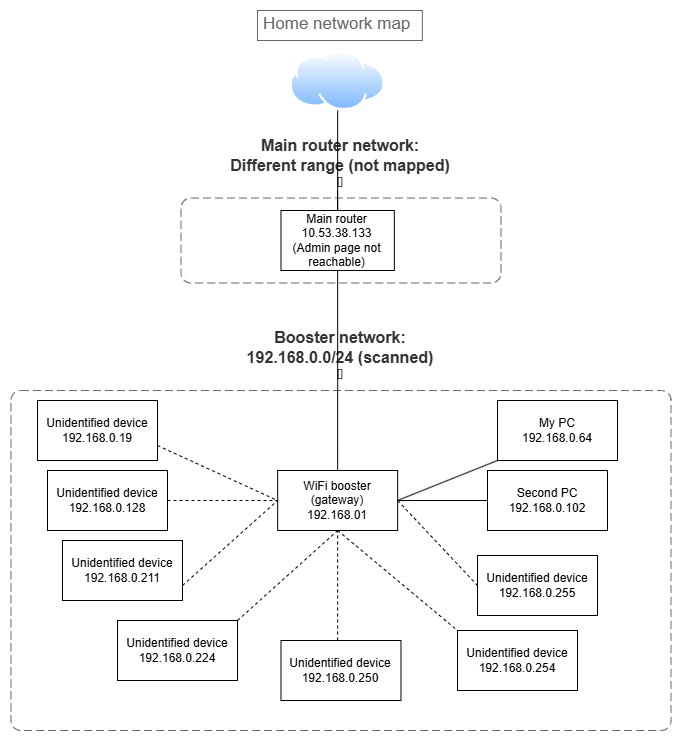

# **Home Network Map.**
 ## Overview
 Mapped and documented my home network by using commands in the terminal. I then drew a diagram of my home network in order to understand how my devices connect
 and what the network looks like.

 ## Diagram

## How the addressing works
-Subnet: 192.168.0.0/24, mask 255.255.255.0 254 usable addresses
-

